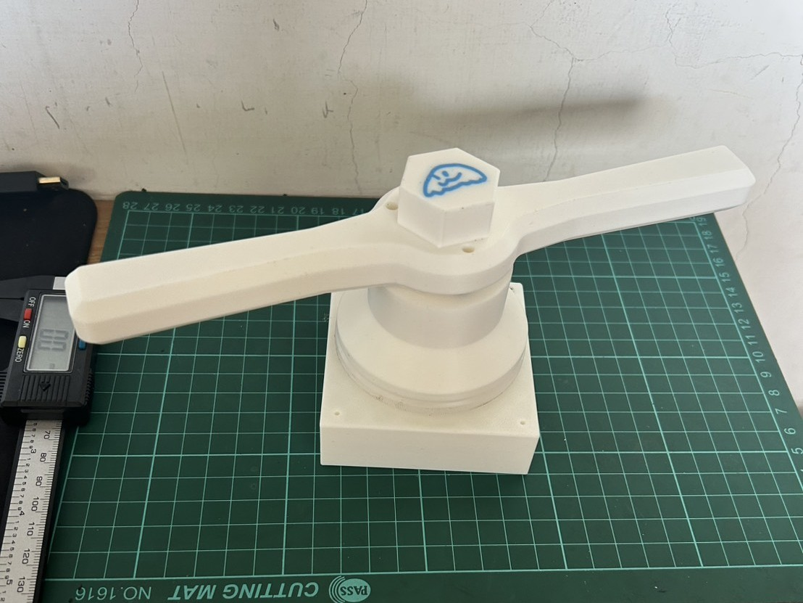
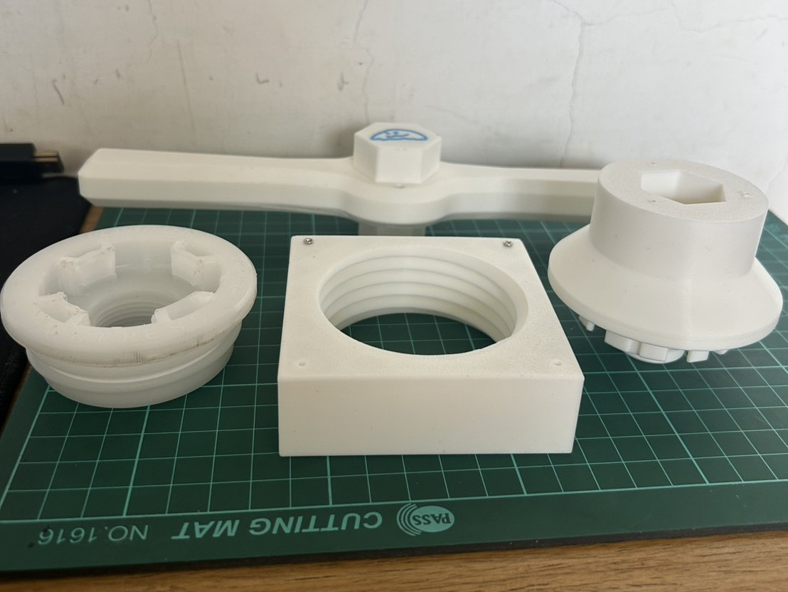
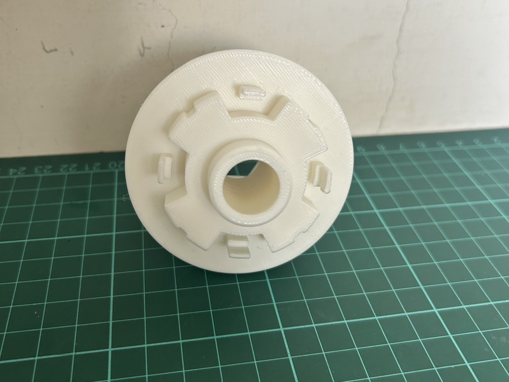
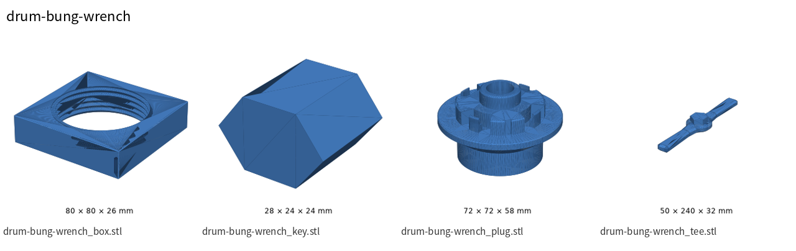

# Drum Bung Wrench for the Tri-Sure 2" Buttress Plastiplug

**English** | [繁體中文](README.zh-TW.md)

A 3D-printable T-handle wrench for the **recessed, screw-in 2" plastic bung** found on plastic drums (alcohol, chemicals) —
for when it is screwed in too tight and sits too deep in the opening to get a grip on it with your fingers.
The plug engages the bowl and the four arc walls on top of the bung, and the 240 mm T-handle gives you a two-handed grip;
the 30 mm hex in the middle takes an adjustable wrench if you need more torque.
A **mock drum opening** (the box) that the bung screws into is included, so you can test without a drum.

Modeled in Python with [build123d](https://github.com/gumyr/build123d); every dimension can be changed in code.

**Download:** [MakerWorld](https://makerworld.com/en/models/3670073) (with a ready-to-print X2D profile) · [Printables](https://www.printables.com/model/1926813) · [GitHub Release](https://github.com/YongRui0402/drum-bung-wrench/releases/latest)

<p>
  
  
  
</p>

Printed in white PLA.



> **Unofficial project.** This project is not affiliated with or endorsed by Tri-Sure or any bung manufacturer.
> "Tri-Sure" and "Plastiplug" are trademarks of their respective owners and are used here only to identify the compatible bung.

## Compatible bung

**Check your bung against this table first.** The wrench was measured against and tested on this one bung only;
bungs with a cross/rib pattern and fine-thread NPS bungs for steel drums will **not** fit.

| Item | Value |
|---|---|
| Product | Tri-Sure 2" Buttress Plastiplug (2" buttress-thread plastic bung with a 3/4" knockout in the center)* |
| Markings on top | `PLASTIPLUG`, `BUTTRESS`, `PAT.6726048`, `6A`, `05PP` |
| Top pattern | Flat rim → recessed bowl; **4 evenly spaced arc walls with slots** in the bowl wall (each slot about 1/8 turn), 4 straight ribs on the bowl floor; a threaded well in the center |
| Flange OD / thickness | 73.0 / 5.4 mm |
| Bowl ID / depth | 52.0 / 12.0 mm |
| Opposite arc walls inner distance / wall thickness / chord length | 36.8 / 3.0 / 12.0 mm (wall tops flush with the rim) |
| Center well thread minor diameter / depth (from bowl floor) | 24.0 / 11.0 mm |
| Rib width / height | 3.0 / about 1.0 mm, 4 ribs |
| Outer thread | Buttress, major diameter 63.2 mm, minor diameter 57.6 mm, pitch about 5.0 mm* (5 TPI = 5.08 is possible), 3 turns, single start |
| Overall height | 26.6 mm |
| Factory tightening torque | about 27 N·m (20 ft-lb)* |

Dimensions were measured with calipers on one bung. Items marked * were not measured directly:
the product name was matched from the markings to a reseller listing, only a single pitch could be measured, and the torque is a reseller spec.

## Parts

| File | Size (mm) | Print orientation |
|---|---|---|
| `models/drum-bung-wrench_plug.stl` (plug) | 72.0 × 72.0 × 57.6 | Round face with the hex socket (hub top) on the bed |
| `models/drum-bung-wrench_key.stl` (hex key) | 27.7 × 23.8 × 24.0 | Lying down, a flat side on the bed |
| `models/drum-bung-wrench_tee.stl` (T-handle) | 50.0 × 240.0 × 32.0 | Flat bottom on the bed (arms along Y) |
| `models/drum-bung-wrench_box.stl` (mock drum opening, optional) | 80.0 × 80.0 × 26.0 | The face with the corner holes on the bed |

The STLs are already in print orientation — **do not let the slicer auto-orient them.**
`models/` also contains a STEP for each part, plus the assembly (`_assembly.step`) and exploded view (`_assembly_exploded.step`) with a mock bung for reference.

## Printing

- Test-printed on a Bambu Lab X2D: PLA, 0.20 mm layers, **no supports**.
- Torque is carried across layers, so use plenty of walls and infill:

| Part | Walls | Infill |
|---|---|---|
| Plug | 4 | 20%, 100% inside the central Ø54 (modifier) |
| Hex key | — | 100% |
| T-handle | 5 | 15%, 100% inside the Ø50 hub (modifier) |
| Box | 3 | 10% |

- The T-handle is 240 mm long and needs a bed of at least 256 mm (e.g. X1 / P1 / X2D series); 180 mm beds such as the A1 mini are too small.

## Assembly and use

1. Press the hex key into the hex socket on top of the plug, then press the T-handle's hex socket onto it (sand the key if it is too tight).
2. Drive 3 **M2×12 self-tapping screws** from the top of the T-handle into the plug so it can't pull apart.
3. Put the plug onto the bung: claws into the 4 slots, plug filling the bowl, base flat on the bung's rim — then turn the T-handle.
4. If two hands are not enough, put an adjustable wrench on the 30 mm hex in the middle of the T-handle.

**Caution:**

- The drum may be under pressure (alcohol evaporates): **loosen a little first to let it vent**, then unscrew completely.
- The center well is a 3/4" knockout with a deliberately thin bottom. The plug's pilot never touches it — **don't push down hard**, or you may punch it through.

## Fit and tolerances

Dimensions were tuned on one printer. If your prints come out too tight or too loose, adjust these constants in `src/dims.py`:

- `PLUG_GAP`: clearance between the plug and the bung (per side, default 0.25 mm). `FIT_GAP` also has 0.10 / 0.40; print a quarter-turn fit coupon with `src/test_coupon.py` to try them.
- `THREAD_RAD_CLR`: radial clearance of the box's internal thread (per side, default 1.0 mm).
- `THREAD_PITCH`: thread pitch (default 5.0 mm). If the bung gets tighter as it screws in, try 5.08.
- `KEY_CLR`: across-flats clearance of the hex key sockets (default 0.2 mm).

## Rebuilding and modifying

Requires [uv](https://docs.astral.sh/uv/) (Python 3.11–3.14).

```sh
cd src
uv run python plug.py       # plug      -> src/build/
uv run python key.py        # hex key
uv run python tee.py        # T-handle
uv run python box.py        # mock drum opening
uv run python assembly.py   # assembly STEP (run the four above first)
```

With the versions locked in `uv.lock` (`build123d==0.13.0`, `bd_warehouse==0.4.0`), the rebuilt STLs are byte-identical to the ones in `models/`.
Code comments are in Traditional Chinese, and each constant notes where its value came from.
`test_coupon.py` and `thread_ring.py` are modules shared by the plug and the box; run on their own they produce the fit coupons and a half-turn thread test ring.

## License

| Content | License |
|---|---|
| Code (`src/`, `pyproject.toml`) | [MIT](LICENSE) |
| Models (`models/`), images (`docs/`) and documentation | [CC BY 4.0](LICENSE-CC-BY-4.0.txt) |

You may print, sell prints, modify and redistribute, as long as you give credit
(e.g. "Drum Bung Wrench by YongRui0402" with a link to this repo).
