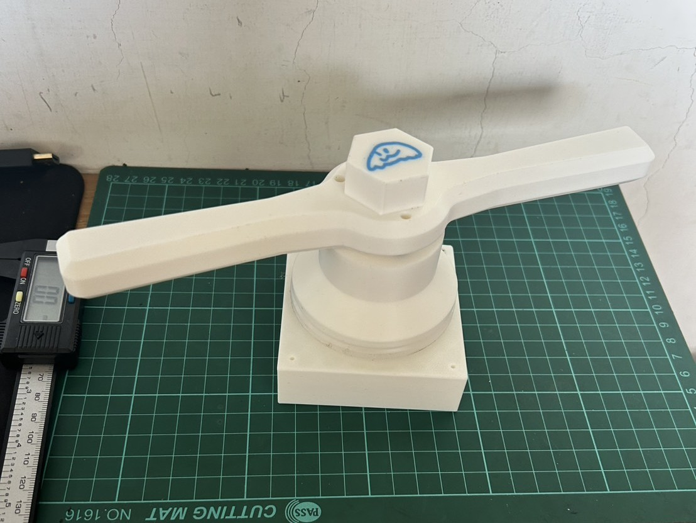
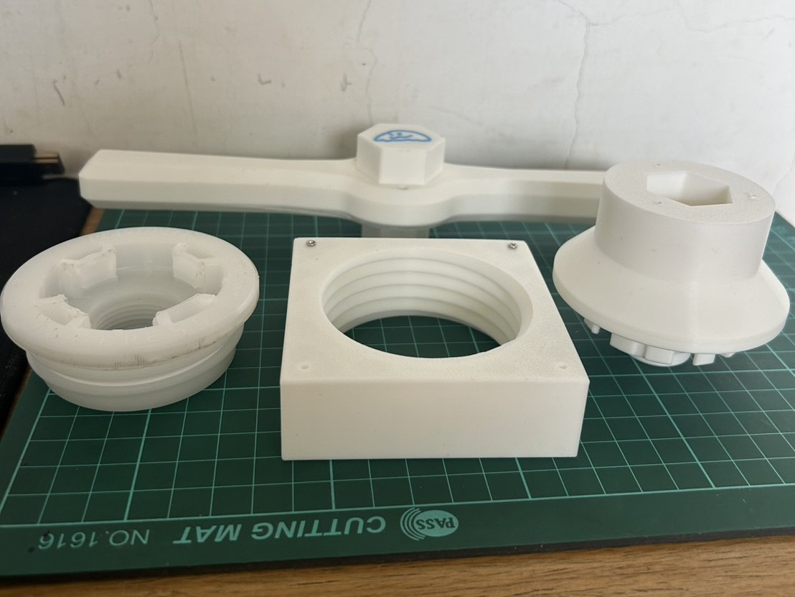
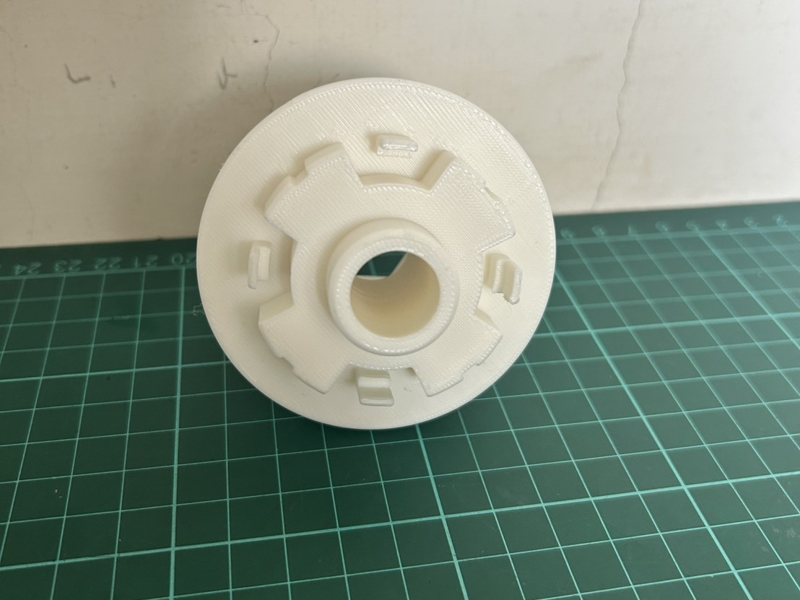
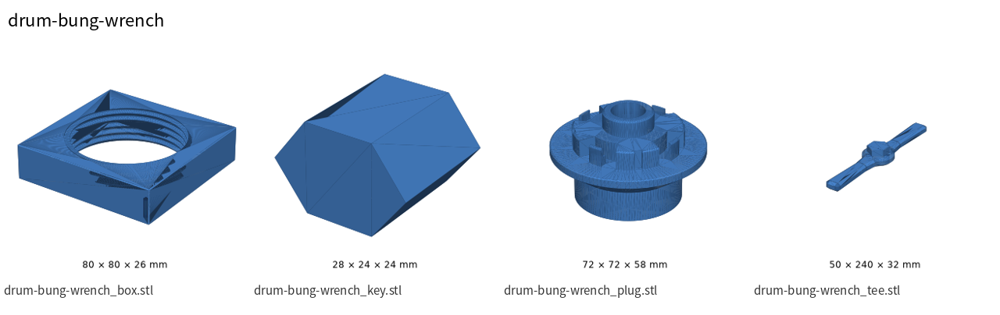

# 塑膠桶塞扳手(Tri-Sure 2" Buttress Plastiplug 用)

[English](README.md) | **繁體中文**

酒精桶、化學品塑膠桶上那種**旋入式、沉在桶口裡**的 2 吋塑膠桶塞,鎖太緊、手指又施不了力時用的 3D 列印 T 型扳手。
插頭扣進蓋面的碗與四道弧牆出力,240 mm 的 T 把雙手施力;中間的六角(對邊 30 mm)還能再接活動扳手加力。
另附一個轉得進蓋子的**模擬桶口**(方盒),手邊沒有桶時可以拿來測試。

以 Python 的 [build123d](https://github.com/gumyr/build123d) 建模,所有尺寸都能在程式裡修改。

**下載:** [MakerWorld](https://makerworld.com/en/models/3670073)(附 X2D 列印配置)· [Printables](https://www.printables.com/model/1926813) · [GitHub Release](https://github.com/YongRui0402/drum-bung-wrench/releases/latest)

<p>
  
  
  
</p>

白色 PLA 實際列印。



> **非官方專案。** 本專案與 Tri-Sure 或任何桶塞製造商無關,也未經其認可。
> 「Tri-Sure」與「Plastiplug」是其所有者的商標,這裡只用來說明適用的蓋子。

## 適用的蓋子

**請先對照你手上的蓋子。** 這把扳手只對下面這一種蓋子量過、試過;十字紋的桶塞、鐵桶用的 NPS 細牙桶塞都**不適用**。

| 項目 | 內容 |
|---|---|
| 品名 | Tri-Sure 2" Buttress Plastiplug(2 吋 BUTTRESS 牙塑膠桶塞,中心有 3/4" knockout)* |
| 蓋面刻字 | `PLASTIPLUG`、`BUTTRESS`、`PAT.6726048`、`6A`、`05PP` |
| 蓋面紋路 | 外緣一圈平邊 → 往內下凹成碗;碗壁有 **4 道等分的弧牆與凹槽**(每個凹槽約 1/8 圈),碗底有 4 條直肋;中心是一個有內牙的井 |
| 法蘭外徑 / 厚 | 73.0 / 5.4 mm |
| 碗內徑 / 碗深 | 52.0 / 12.0 mm |
| 對面兩道弧牆內距 / 弧牆厚 / 弧牆弦長 | 36.8 / 3.0 / 12.0 mm(弧牆頂和蓋頂平邊同高) |
| 中心井內牙最窄徑 / 井深(從碗底) | 24.0 / 11.0 mm |
| 直肋寬 / 高 | 3.0 / 約 1.0 mm,4 條 |
| 外牙 | BUTTRESS 鋸齒牙,牙峰外徑 63.2 mm、牙底徑 57.6 mm,牙距約 5.0 mm*(5 TPI = 5.08 也有可能),3 圈、單頭 |
| 蓋子總高 | 26.6 mm |
| 原廠鎖緊扭力 | 約 27 N·m(20 ft-lb)* |

尺寸是用卡尺量一顆實物得到的。標 * 的不是直接量到的值:品名是依蓋面刻字對到的賣家商品名,牙距只量到一個牙距,扭力是賣家規格。

## 零件

| 檔案 | 尺寸 (mm) | 列印擺法 |
|---|---|---|
| `models/drum-bung-wrench_plug.stl`(插頭) | 72.0 × 72.0 × 57.6 | 有六角孔的圓面(輪轂頂面)貼熱床 |
| `models/drum-bung-wrench_key.stl`(六角鍵) | 27.7 × 23.8 × 24.0 | 平邊貼熱床、躺著印 |
| `models/drum-bung-wrench_tee.stl`(T 把) | 50.0 × 240.0 × 32.0 | 平底貼熱床(臂沿 Y 軸) |
| `models/drum-bung-wrench_box.stl`(模擬桶口方盒,選用) | 80.0 × 80.0 × 26.0 | 四角有插孔的那面貼熱床 |

STL 已經是列印擺法,**切片時不要讓切片軟體自動調整方向**。`models/` 裡還有每個零件的 STEP,以及整組組裝(`_assembly.step`)與爆炸圖(`_assembly_exploded.step`),內含示意用的蓋子。

## 列印

- 在 Bambu Lab X2D 上試印過:PLA、層高 0.20 mm、**不加支撐**。
- 扭力都在層與層之間傳遞,牆數與填充建議開高:

| 零件 | 牆數 | 填充 |
|---|---|---|
| 插頭 | 4 | 20%,中心 Ø54 範圍內 100%(用修改器) |
| 六角鍵 | — | 100% |
| T 把 | 5 | 15%,中間輪轂 Ø50 範圍內 100%(用修改器) |
| 方盒 | 3 | 10% |

- T 把長 240 mm,熱床要 ≥ 256 mm(例如 X1/P1/X2D 系列);A1 mini 這類 180 mm 熱床放不下。

## 組裝與使用

1. 六角鍵壓進插頭頂面的六角槽,再把 T 把的六角槽對準壓上去(太緊就用砂紙磨鍵)。
2. 3 顆 **M2×12 自攻螺絲**從 T 把頂面鎖進插頭,防止脫開。
3. 插頭朝下插進蓋子:爪子對準 4 個凹槽、塞子填滿碗,底盤貼平蓋頂後轉動 T 把。
4. 雙手轉不動時,用活動扳手夾 T 把中間的六角(對邊 30 mm)加力。

**注意:**

- 桶子裡可能有壓力(酒精會揮發):**先轉鬆一點讓它洩壓**,再整個轉開。
- 中心的井是 3/4" knockout,井底刻意做薄。插頭的定位柱不會碰到井底,**不要用力往下壓**,以免把它打穿。

## 配合與公差

尺寸在一台印表機上調過。如果你的印表機印出來偏緊或偏鬆,請修改 `src/dims.py` 裡的這幾個常數:

- `PLUG_GAP`:插頭塞進蓋子的間隙(每邊,預設 0.25 mm)。`FIT_GAP` 裡另有 0.10 / 0.40 兩種,可以先用 `src/test_coupon.py` 印一片 1/4 圈的配合測試片試插。
- `THREAD_RAD_CLR`:方盒內牙的徑向間隙(每邊,預設 1.0 mm)。
- `THREAD_PITCH`:牙距(預設 5.0 mm)。轉到一半越來越緊,可以改成 5.08 試試。
- `KEY_CLR`:六角鍵槽的對邊公差(預設 0.2 mm)。

## 重建與修改

需要 [uv](https://docs.astral.sh/uv/)(Python 3.11–3.14)。

```sh
cd src
uv run python plug.py       # 插頭      -> src/build/
uv run python key.py        # 六角鍵
uv run python tee.py        # T 把
uv run python box.py        # 模擬桶口方盒
uv run python assembly.py   # 組裝 STEP(要先跑上面四個)
```

使用 `uv.lock` 鎖定的版本(`build123d==0.13.0`、`bd_warehouse==0.4.0`)時,重建出來的 STL 和 `models/` 裡的逐位元組相同。
程式註解是繁體中文,每個常數都註明了數值的來源。`test_coupon.py`、`thread_ring.py` 是插頭與方盒共用的模組,單獨執行時會產生配合測試片與 1/2 圈的牙環測試片。

## 授權

| 內容 | 授權 |
|---|---|
| 程式碼(`src/`、`pyproject.toml`) | [MIT](LICENSE) |
| 模型(`models/`)、圖片(`docs/`)與說明文件 | [CC BY 4.0](LICENSE-CC-BY-4.0.txt) |

可以列印、販售列印成品、修改與再散布,只要標明出處即可
(例如「Drum Bung Wrench by YongRui0402」,並附上這個 repo 的連結)。
